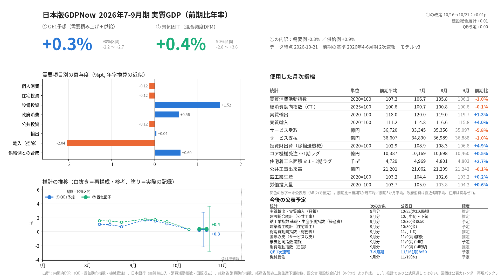

# 日本版GDPNow（jp-gdpnow）

アトランタ連銀 GDPNow の考え方で作った、日本の実質GDP（QE1次速報・前期比年率）のナウキャスト。

> [!IMPORTANT]
> - **個人が趣味で作っているモデルの推計値です。** 内閣府・日本銀行など公的機関の見通しではなく、各機関とも関係ありません。投資判断などには使わないでください。
> - **リアルタイムの記録は 2026-10-16 から**（`data/runs.csv`）。それより前の精度の数字は、改定後のデータを公表カレンダーで切り出した**擬似リアルタイムのバックテスト**で、実際の成績より良く出ている可能性があります。
> - 目安（2016–19年・2021–26年の35四半期, QE1直前）：平均絶対誤差 1.08%pt, RMSE 1.40%pt（前期比年率）。四半期の早い時期（2か月目）は、過去平均を当てるのと統計的に差がありません。詳しくは `SKILL.md`。



**予想の変化の記録**（いつ・どの統計で・どれだけ動いたか）→ [data/HISTORY.md](data/HISTORY.md)

## 2つのエンジン
- **① QE1予想**：需要項目別のブリッジ方程式の積み上げと、供給側（鉱工業生産＋労働投入）を 50:50 で合成（モデル v3）
- **② 景気因子**：月次16系列と四半期GDPの混合頻度ダイナミック・ファクター・モデル

それぞれ90%予測区間（過去の公表カレンダー再現バックテストの誤差から作成）と、前回からの「ニュース分解」を出す。

## 自動実行（GitHub Actions）
`.github/workflows/nowcast.yml` は平日 12:07 と 16:43（日本時間）に設定。GitHub の定時実行は実測で約5時間遅れるため前倒ししてあり、実際にはおおむね 17時ごろと 21時40分ごろに動く。新しいデータが無ければ何もしない。

- 各統計の最新値を取得し、`data/vintages.sqlite` に差分だけ保存（ヴィンテージ）
- 前回から新しい・改定されたデータがあった日だけ予想を記録し、`data/runs.csv` と `output/` をコミット
- 手動実行：Actions タブ → nowcast → Run workflow（`force` にチェックすると新データが無くても実行）

必要な Secret：`ESTAT_APP_ID`（e-Stat API のアプリケーションID）

## 手元で実行
```bash
pip install -r requirements.txt
export ESTAT_APP_ID=...            # Windows PowerShell: $env:ESTAT_APP_ID="..."
export JP_GDPNOW_HOME=$PWD/data    # Windows PowerShell: $env:JP_GDPNOW_HOME="$PWD\data"
python -m scripts.cli nowcast --out output          # 予想・記録・レポート画像
python -m scripts.cli backtest --mode dates         # 公表カレンダー再現バックテスト
python -m scripts.cli history                       # 記録した予想の推移
```

## フォルダ
| パス | 中身 |
|---|---|
| `scripts/` | モデル本体（data, model, factor, release, news, bands, vintage, plots, cli ほか） |
| `scripts/schedule.csv` | 今後の公表予定（手で更新する。四半期ごとに次の期の日程を追加） |
| `vendor/` | データ取得に使う esri-data・boj-api・estat-api スキルのモジュール（同梱コピー） |
| `data/` | ヴィンテージDB、予想の記録 `runs.csv`、変化の記録 `HISTORY.md`、ニュース分解の記録 `news_log.csv` |
| `output/` | レポート画像（`latest.png` が最新）と内訳CSV |
| `SKILL.md` | 設計・検証結果・不採用案の記録 |

## データの出典と利用条件
`data/vintages.sqlite` には、下の各機関が公表したデータを取得日ごとに保存しています（元データは無加工、モデルの入力に使う季節調整・実質化などは計算時に行う）。予想値・レポート画像は、これらを加工して作成したものです。

| 出典 | 使っているデータ | 利用条件 |
|---|---|---|
| 内閣府 経済社会総合研究所 | 四半期別GDP速報（QE）、景気動向指数の個別系列、機械受注 | [https://www.cao.go.jp/notice/rule.html](https://www.cao.go.jp/notice/rule.html)（公共データ利用規約 第1.0版） |
| 日本銀行 | 実質輸出入、消費活動指数、国際収支（サービス収支）、企業物価・企業向けサービス価格 | [https://www.boj.or.jp/about/copyright.htm](https://www.boj.or.jp/about/copyright.htm)（出所明記で転載可） |
| 経済産業省 | 鉱工業指数（財別）、製造工業生産予測指数、第3次産業活動指数 | [https://www.meti.go.jp/main/rules.html](https://www.meti.go.jp/main/rules.html)（公共データ利用規約 第1.0版） |
| 総務省（e-Stat） | 消費動向指数（CTI） | [https://www.e-stat.go.jp/api/terms-of-use](https://www.e-stat.go.jp/api/terms-of-use) |
| 国土交通省（e-Stat） | 建設総合統計 | 同上 |

出典の表記例：「四半期別GDP速報」（内閣府）、「鉱工業指数」（経済産業省）等を加工して作成。

このサービスは、政府統計総合窓口(e-Stat)のAPI機能を使用していますが、サービスの内容は国によって保証されたものではありません。

## ライセンス
- コード（`scripts/`, `vendor/`, ワークフロー）：MIT License（`LICENSE`）
- データ：上表の各出典の利用条件に従います（MIT の対象外）。
